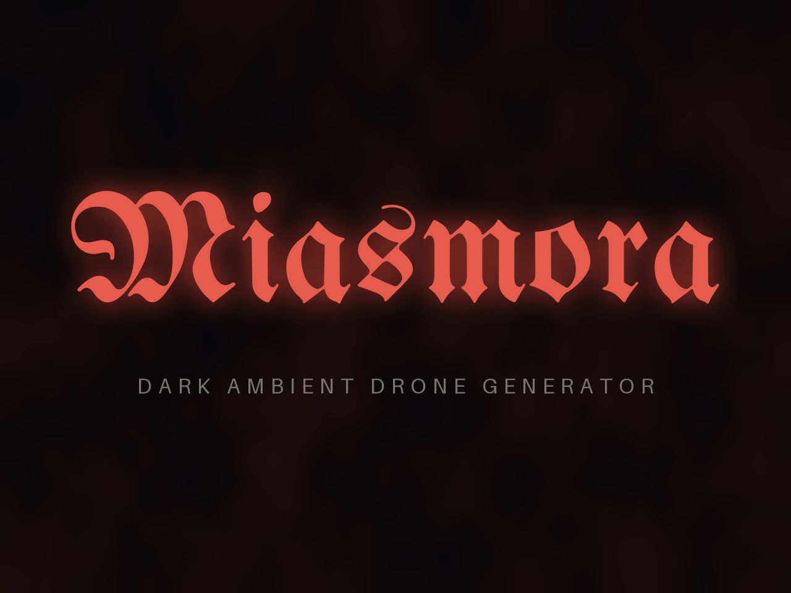

<p align="center"></p>

*[日本語版はこちら / Japanese version here](README_ja.md)*

Firmware that turns the **M5Stack Cardputer ADV** into a **dark ambient drone generator**, developed with PlatformIO and the Arduino framework. I describe my ideas to Claude, and Claude writes the code.

MIASMORA keeps playing the kind of uneasy, dark drone you hear in horror games and films: a low sub that breathes, detuned chords beating against each other, air moving through ducts, rusted metal, a broken TV, footsteps upstairs, something being dragged, things crawling. **Everything is synthesised in real time. No samples are used anywhere.**

There are three ways to use it.

| | Use | Main features |
|---|---|---|
| **Make material** | Shape a mood, export it as WAV and use it in your DAW | Seamless loops, stems, batches, one-shot sound effects |
| **Leave it running** | Let it play in the room | Drift and Arc keep it changing by itself, Listen reacts to sounds in the room, and with Cursed Mode strange things happen now and then |
| **Play** | Tilt it, or hide it | PLANCHETTE (tilt it to feel your way through a mood), Poltergeist (hide it as a prank) |

It is the sister firmware of **Ensō**, which plays calm ambient sound, and builds on Ensō's structure and the lessons learned making it.

**The name.** MIASMORA combines *miasma* (the bad air once thought to carry disease and ill fortune) and *-ora*.

I share development progress on Reddit and on my [Twitter (X) account](https://x.com/Tokagetchi).

> **This project is currently 100% vibe-coded!**
> My apologies to anyone uncomfortable with AI use or vibe coding!

> **Status: v1.0 — first public release.**

---

## Key Features

### 25 fully synthesised layers

- **11 DRONE layers** (SUB, CLUSTER, AIR, METAL, STATIC, MACHINE, DISCORD, MICRO, VOX, SHEPARD, HEART), **13 EVENTS layers** (PULSE, CREAK, SWELL, DRIP, SCRAPE, DRAG, STEPS, SKITTER, INSECT, KNOCK, DRILL, CLANG, BUMP) and **SPACE** (REVERB). Each has its own level, on / off and parameters
- **DREAD**: one knob (0–100) that moves the chords' beating, the thickness of the air, the strength of the metal, the instability of the static, how often events come and how deep everything wobbles, all at once
- Struck and rubbed sounds are made by driving resonators with noise and impulses, never with a pitched oscillator

### Moods and seeds

- **24 presets** (Ward, Fog Town, Boiler Room, Abyss, Cellar, Rust, Otherworld, Hollow, Dead Channel, Night Radio, Upstairs, Crawlspace, Infestation, Night Shift, Visitor, Presence, Workshop, Pipes, Requiem, Descent, Out of Tune, Threnody, Ritual, Inside) and custom scenes saved on SD
- A **6-digit seed** decides everything random. Pass on a mood's name and seed and someone else's device plays the same sound (e.g. `Crawlspace #418207`)
- `R` makes a random scene, *Unknown*, from the seed

### Changing by itself, reacting to the room

- **Drift**: layers come in, fade away or swap places, values move — each change over a slow crossfade
- **Arc**: over 10–30 minutes it carries the mood through *Calm* → *Build* → *Peak* (with a climax) → *Release*
- **Listen**: the microphone measures how loud the room is (**nothing is recorded**). A sudden sound makes everything fall silent (a Hush); the longer nothing happens, the more uneasy it gets
- **Watcher**: on a Hush, an Eye of Providence drawn like an old engraving opens, searches the room, then stares at you
- **Cursed Mode**: only if you accept it, strange things happen now and then (the mood changes by itself, the screen flickers, sounds you did not turn on sneak in…)

### Play

- **PLANCHETTE**: tilt the device to feel your way through the mood, and save or export it where it feels right
- **Poltergeist**: hide the device, and now and then it knocks, drips or creeps about, with the screen dark. It goes quiet when people are near and notices when it is picked up

### Export and recording

- **WAV loops**: 8 / 16 / 32 / 64 s. *Crossfade* (the seam overlapped smoothly) or *Strict* (a mathematically periodic loop)
- **Stems** (drones and events apart), **batches** (5–50 on consecutive seeds), **one-shots** (sound effects)
- **Live recording**: records exactly what you hear, knob-twiddling included

---

## Hardware

| Item | Details |
|---|---|
| Device | **M5Stack Cardputer ADV** (ESP32-S3, no PSRAM needed) |
| Audio | Built-in speaker + 3.5 mm jack, **mono** |
| Storage | microSD (FAT32; settings, scenes, exports, recordings) |
| Tilt | Built-in IMU (BMI270). Used for Shake, PLANCHETTE, Poltergeist and Watcher's gaze |
| Microphone | Built-in (the ES8311's input). Listen and Poltergeist's Shy use its levels only |
| LED | Built-in RGB LED (WS2812, GPIO21). It pulses dark red with Watcher |
| Listening | Earphones recommended (the built-in speaker barely reproduces the low notes of HEART and SUB) |

> The original Cardputer (non-ADV) has not been tested. Without an IMU, PLANCHETTE and Poltergeist's When Found are unavailable, and `Fn+S` stands in for the Shake gesture.

---

## Installation

### Method 1 — M5Burner (easiest, recommended)

Open the page and flash it from your browser:

| | M5Burner |
|---|---|
| MIASMORA | https://burner.m5stack.com/share/firmware/3NRPTY |

1. Connect the Cardputer ADV to your computer with USB-C
2. Open the link above in a browser that supports Web Serial (Chrome or Edge on a PC)
3. Press the flash button and choose the Cardputer's port
4. When writing finishes, MIASMORA starts

> MIASMORA is on the new web version of M5Burner. It may not appear in the older M5Burner desktop app.

### Method 2 — Through Launcher FW

#### Method 2a — Using OTA

1. Start Launcher FW on the Cardputer ADV
2. Search for "MIASMORA" in the OTA function
3. Download and install

> If MIASMORA doesn't show up in the OTA list, use Method 2b.

#### Method 2b — Copying to the SD card by hand

1. Download the latest `firmware.bin` from the [Releases](../../releases) page
2. Copy `firmware.bin` to the **root** of the SD card (not into a subfolder)
3. Insert the SD card into the Cardputer ADV, choose `firmware.bin` in Launcher FW's file browser and flash it

> Started from Launcher FW, waking from deep sleep with `G0` returns to Launcher rather than to MIASMORA (waking is a restart, and what starts is Launcher). Start MIASMORA again from Launcher; your settings and the last mood are kept. Flashed with Method 1, it wakes straight into MIASMORA.

### Method 3 — Build from source (PlatformIO)

1. Install the **PlatformIO IDE** extension in [VSCode](https://code.visualstudio.com/)
2. Clone or download this repository and open the folder
3. `platformio.ini` is picked up automatically, and the first build downloads the libraries it needs
4. `pio run` builds it. The environment is `m5stack-cardputer-adv`

```bash
pio run -e m5stack-cardputer-adv -t upload
```

A build leaves `firmware.bin` (the app only, for Launcher FW) and `merge.bin` (bootloader + partitions + app in one image, for M5Burner and similar tools; made by `merge_bin.py`) in `.pio/build/m5stack-cardputer-adv/`.

> **If it won't enter flashing mode**: power off → hold the G0 button while powering on → release G0

### First start (all methods)

After the start screen comes MAIN (stopped at first; `Space` plays). A `/MIASMORA` folder is created on the microSD card, and settings and scenes are saved there.

Without an SD card it runs on the initial settings, but nothing is saved, and export and recording are unavailable.

---

## Controls

There are five screens: MAIN, MOOD, EDIT, EXPORT and SETTINGS. `H` shows the help (the keys and the device's state).

### Keys that work on every screen

| Key | Action |
|---|---|
| `Space` | Play / stop (with Seed Lock off, every start uses a new seed) |
| `M` / `E` / `X` / `S` | MOOD / EDIT / EXPORT / SETTINGS screen |
| `Tab` | Next screen |
| `` ` `` (Esc) | Back (to MAIN) |
| `;` / `.` | Choose a setting (up / down) |
| `,` / `/` | Change the value (hold to move faster) |
| `R` | Random scene (*Unknown*) |
| `Shift+R` | Live recording start / stop |
| `Shift+S` | Sleep timer on / off |
| `Fn+S` | Run the Shake action |
| `H` | Help / About |
| `G0` button | Display off / on (also wakes the device from deep sleep) |

> **Coming from Ensō?** There `Shift+S` stands in for a shake; in MIASMORA **`Shift+S` is the sleep timer**, and the shake is **`Fn+S`**.

### MAIN screen

Shows the mood, DREAD (with Arc, Listen and Cursed added in), the visualiser, the seed, play / REC state, the sleep timer and the battery. With Arc on, a thin bar under the visualiser shows how far it has got.

| Key | Action |
|---|---|
| `;` / `.` | Volume up / down |
| `,` / `/` | Previous / next mood (crossfades) |
| `Shift+;` / `Shift+.` | DREAD up / down |
| `0`–`9` | Type a seed (applies on the 6th digit; `Del` erases one, Esc cancels). On *Unknown* and *Drift* the scene is made again from the typed seed |
| `V` | Next visualiser |
| `Q` | Quick Save: what you hear as a scene *Shake_001*, *Shake_002*, … (the current scene stays) |
| `P` | PLANCHETTE |
| `G` | Poltergeist's settings |

The visualiser shows the device's own output (never the microphone).

| Kind | What it shows |
|---|---|
| Off | Nothing |
| Bars | The recent output level as mirrored bars |
| Scope | The waveform, held still on its rising edges, with an automatic gain |
| Monitor | An ECG-like line of the level; every event and heartbeat is a spike |
| Layers | The layers that sound and how loud each is now, the loudest first |
| Ink | A red stain seeping from the centre; a drop flung out with every event, darker and more ragged with DREAD |
| Spectrum | A spectrogram (about 50 Hz–6 kHz); SHEPARD's endless fall and VOX's vowels draw patterns |

### MOOD screen

| Key | Action |
|---|---|
| `Enter` | Play the selected mood |
| `N` | Save the current sound as a new custom scene |
| `D` | Delete a custom scene (presets and Drift can't be deleted) |

Edits to a preset are kept (across restarts too), but the preset itself is never overwritten; save them with `N`. Edits to a custom scene are saved into its file by themselves.

**Sharing a mood.** Pass on the mood's name and the seed (e.g. `Crawlspace #418207`): a preset or an *Unknown* scene with the same seed sounds the same. For Drift add its speed (`Drift Mid #418207`; the same path needs Drift's other settings at their defaults and Arc off). For *Unknown* add the firmware version too (`Unknown #418207 v1.0`). A scene you built in EDIT is a file: share it from `/MIASMORA/scene/`.

### EDIT screen

The layer list is divided into DRONE / EVENTS / SPACE.

| Key | Action |
|---|---|
| `;` / `.` | Choose a layer |
| `,` / `/` | Level |
| `O` | On / off |
| `Enter` | Open its parameters (`;` `.` choose, `,` `/` change, Esc goes back) |

### Shake

Shaking the device runs the action chosen in SETTINGS > Motion > *Shake Action* (`Fn+S` from the keyboard). It is not taken while exporting, during the sleep fade, while a dialog is open, or in PLANCHETTE and Poltergeist.

| Action | What it does |
|---|---|
| Random Scene | As `R` |
| Sleep Timer | Switches the sleep timer on; again: off |
| Display Off | Switches the screen off (the sound keeps playing) |
| New Seed | A new seed: the sound dips over 1 s and comes back on the new seed over 1.5 s |
| Next Mood | The next mood |
| Hush | The Listen Hush (with Listen off too) |
| Summon | One event of a layer that is playing, now (nothing is cut off) |
| Drift Now | The next Drift change at once |
| Quick Save | As `Q` on MAIN |

### Sleep timer

`Shift+S` switches it on / off (it is always off after power-on). After 1–240 minutes it fades out (10–120 s) and either goes into **deep sleep** or stops and switches the screen off (SETTINGS > Sleep > After). `G0` wakes it from deep sleep. It waits for an export or a recording to finish first.

---

## Sound layers

### DRONE (sustained)

| Layer | What it is | Parameters |
|---|---|---|
| **SUB** | A 30–70 Hz sine through a waveshaper; its pitch drifts a few cents and its level breathes | Level · Pitch · Drive · Drift |
| **CLUSTER** | Four slightly detuned voices under a dark, moving low-pass. The beating is the unease | Level · Interval (Unison / Minor 2nd / Tritone / Cluster) · Detune · Darkness |
| **AIR** | Pink or brown noise through a slowly moving band-pass: wind, ducts, a distant machine | Level · Color · Motion · Noise (Pink / Brown) |
| **METAL** | Two-operator FM at a non-integer ratio: rusted metal, a far-off bell | Level · Ratio · Index · Motion |
| **MACHINE** | Machinery somewhere in the building. *Motor*: rotor thrum and bearing rumble. *Engine*: a low, rough idle that sometimes misfires | Level · Mode (Motor / Engine) · Speed · Load |
| **STATIC** | *TV*: hiss and mains hum. *Radio*: AM noise and crackle. *Tuning*: heterodyne whistles and fragments of something like a voice. *Proximity*: the "something is near" radio | Level · Mode (TV / Radio / Tuning / Proximity) · Tone · Instability |
| **DISCORD** | A dissonant pad of 4–6 voices; now and then one sags and comes back | Level · Chord (MinMaj / Dim b9 / Poly / Cluster / Tritone) · Pitch · Detune · Darkness · Slide |
| **MICRO** | A pad on intervals outside the twelve notes (quarter tones, sixth tones, Bohlen–Pierce…); every voice glides to the neighbouring microtone, so it squirms | Level · Tuning (Quarter / Sixth / BP / Beating / Stretched) · Pitch · Spread · Glide · Wave (Sine / Saw) |
| **VOX** | A wordless choir whose vowel drifts too slowly to form words. *Choir*, *Hum* (closed mouth), *Moan* | Level · Mode (Choir / Hum / Moan) · Pitch · Vowel · Motion · Breath |
| **SHEPARD** | The endless fall (or rise). Six sines | Level · Direction (Down / Up) · Speed · Spacing (Octave / Tritone) · Tone |
| **HEART** | A heartbeat heard from inside — a muffled "lub-dub" and the rush of blood. It speeds up with tension and stops for a beat on a Hush; Attack makes the beat audible on the built-in speaker | Level · BPM · Irregularity · Muffle · Flow · React · Attack |

### EVENTS (irregular one-shots and gestures)

Every event layer has **Level** and **Density** (how often).

| Layer | What it is | Other parameters |
|---|---|---|
| **PULSE** | A low thump and a short click; sometimes a double hit like a heartbeat | Weight |
| **CREAK** | A stick-slip creak: floorboards, an old chair | Pitch |
| **SWELL** | Swells up as if played backwards, then cuts off | Length |
| **DRIP** | Water drops; sometimes a second, smaller one | Size · Mode (Random / Leak) |
| **SCRAPE** | Nails or metal along a surface | Material (Wood ↔ Metal) · Pressure |
| **DRAG** | Something dragged across the floor. *Body*: something heavy. *Pipe*: a metal pipe | Weight · Roughness · Object (Body / Pipe) |
| **STEPS** | 4–12 hard-soled footsteps; sometimes they stop halfway… | Surface (Wood / Concrete / Metal / Gravel) · Direction (Approach / Recede / Pass) · Pace · Muffle |
| **SKITTER** | Many legs that run, stop and run again | Size · Swarm |
| **INSECT** | Unpleasant insects: Fly, Mosquito, Cicada, Wrong Chirp | Mode · Count |
| **KNOCK** | At a wooden door. *Knock*: groups of knocks. *Tap*: slow, light taps | Style (Knock / Tap) · Distance |
| **DRILL** | A power drill or grinder somewhere | Pitch · Grind |
| **CLANG** | Scrap metal being struck. *Pipe*: a pipe. *Sheet*: a buzzing steel sheet | Object (Pipe / Sheet) · Size · Distance |
| **BUMP** | Dull bumps in the walls or pipes | Pitch · Cluster |

### SPACE

| Layer | What it is | Parameters |
|---|---|---|
| **REVERB** | Schroeder reverb (4 combs + 2 allpasses), out to ruin and cave lengths | Mix · Size · Damping |

---

## Changing by itself, reacting to the room

### Drift

A scene that keeps changing. After a wait, layers come in, fade away or swap places, levels and parameters move, DREAD rises and falls — each change over a slow crossfade. Its path is seed-driven too. SETTINGS > Drift sets the speed (Slow / Mid / Fast / Custom), how many layers sound at once, and which layers Drift may touch at all (*Drift Pool*).

### Arc

Over 10 / 20 / 30 minutes, whatever plays goes from *Calm* (DREAD −20, fewer events) through *Build* to *Peak* (DREAD +30, more events) and settles in *Release*. In the Peak comes one **climax**: the scene's events answer one after another, the heart races, the static bursts out, then a click, a few seconds of silence, and Release. *Once* (one pass) or *Loop*; with *Follows Sleep* it fits itself to the sleep timer.

### Listen

Only after you accept a consent screen. The microphone measures how loud the room is (**levels only — nothing is recorded or saved**).

- The longer nothing happens in the room, the more *Attention* builds up: more events, higher DREAD
- A sudden sound — a cough, a clap, a knock, the start of a voice — makes everything **Hush**: it drops to almost nothing within 0.3 s, holds for 3–8 s and creeps back over 10–20 s. Sometimes a single knock or footstep breaks the silence just before
- It does not react to its own sound, to its own keyboard, or to the device being moved (seen by the IMU)
- When sound keeps going (a TV, a conversation), it rests for 20 s after four Hushes within a minute

### Watcher

On a Hush, an Eye of Providence printed like an old engraving (bone-coloured ink, a red iris, a single eye) opens on MAIN in place of the visualiser. It searches the room, then stares at you, and closes as the sound comes back. Tilt the device and it keeps looking at you. The LED pulses dark red meanwhile.

### Cursed Mode

Only after you accept a warning. Now and then (Rare / Normal / Often) something strange happens: the mood changes by itself, the screen flickers or goes dark, a sound you did not turn on sneaks in, the eye opens for an instant, a burst of static ends in a click and dead silence, the heartbeat stops… Nothing is ever deleted. Nothing happens while exporting or recording, or during the sleep fade.

---

## PLANCHETTE

Tilt the device to feel your way through the mood, and save it where it feels right (named after the pointer of a ouija board). `P` on MAIN enters it; the posture you enter with is the centre.

| Tilt | Changes |
|---|---|
| Forward / back | DREAD +30 … −30 and the event rate about ×2 … ×0.5 |
| Right / left | *Shade*: the reverb — right deep and dark, left dry and bright |

That is the *Axis* mode. In the *Vector* mode (SETTINGS > Motion > Tilt Mode) the tilt blends four scenes sitting in the corners (Fog Town, Cellar, Infestation and Otherworld by default).

| Key | Action |
|---|---|
| `Space` | Hold the values (you can put the device down); again: glide back to the tilt |
| `C` | Take the present posture as the centre |
| `Enter` / `Q` | Save what you hear as a scene *Tilt_001*, *Tilt_002*, … |
| `Shift+X` | Save, then export what you heard as a WAV |
| `Esc` | Leave (the sound stays as it is) |

---

## Poltergeist

A prank: hide the device, and now and then it knocks, drips, scrapes or creeps about — with the screen and the LED dark, so nobody can tell where it comes from or when it will come next. For example: KNOCK and DRIP, Random 2–10 min, behind the bookshelf.

> *Use it on someone who will laugh about it afterwards. Auto Stop is always on, so it won't haunt anyone all night.*

`G` on MAIN opens its page.

| Setting | What it sets |
|---|---|
| Event 1–3 | What it plays (an event layer or HEART, with its Mode — or None) |
| Timing | *Fixed* (the same gap) / *Random* (anywhere between Min and Max; now and then 2–3 in a row) |
| Interval | 10 s – 30 min (default: Random 1–8 min) |
| Escalate | On: the gaps shrink, to 40 % by the end |
| Start Delay | Time to hide it (1–10 min) |
| Auto Stop | 30 min – 4 h (never off) |
| Volume / Room | Its volume, and the reverb on its sounds |
| Shy | On: when it hears people (voices, steps, a cough), it keeps quiet for 30 s – 2 min |
| When Found | Reveal / Silent / ??? — what happens when it is picked up (default Reveal) |
| Test / Start | Play one now / start |

After Start you hide it during the countdown (carrying it about is fine), and it begins once the device lies still. Keys do nothing then. **Hold Esc for 2 s or press G0 to stop it.** At the end it shows how long it haunted, how often it played, how often it fell quiet and after how long it was found, and adds the same to `/MIASMORA/poltergeist_log.txt`.

Between its events it saves power. On a device about a year old, lurking took about **1.5 % of the battery per hour with Shy on** and **under 1 % per hour with Shy off**.

> *Shy listens for people, and a sleeper counts: left right next to a bed with Shy on, it hears the breathing and turning over and stays quiet most of the night. To haunt a sleeping room, set Shy off or hide it a little further away.*

---

## Export and recording

### WAV loop export (EXPORT screen)

| Setting | What it sets |
|---|---|
| Loop Mode | *Crossfade* (the end is overlapped onto the start, so the seam disappears when looped) / *Strict* (LFOs and pitches fitted to the loop: a mathematically periodic loop) |
| Loop Length | 8 / 16 / 32 / 64 s |
| Crossfade | 1 / 2 / 4 s (Crossfade only) |
| Seed | The current seed / a new random one |
| Drift | Freeze (as it is) / Record (with its changes) |
| Arc | Ignore (the scene itself) / Apply (Arc's values when the export starts) |
| Stems | Off / Wet (DRONE and EVENTS, each with its own reverb) / Dry + Reverb (DRONE, EVENTS and the reverb alone; the three add up to the mix) |
| Batch | Off / 5 / 10 / 20 / 50 files on the seed, seed + 1, …; optionally into a folder of their own, and then to sleep |
| Normalize | Off / On (the peak to −1 dBFS) |

`[ Start export ]` starts it. Live playback pauses while it renders; Esc cancels. With EXPORT's Arc on Ignore and Drift on Freeze, the same seed and the same scene always export the same file (Arc's Apply takes Arc's values at the moment the export starts, and Drift's Record records the changes from that moment, so those change from one export to the next).

### One-shots (EXPORT > One-shot)

One event of one layer per file, as sound-effect material, into `/MIASMORA/oneshot/`. Choose the Layer, its Mode, the Unit (a single hit / a whole gesture), the Count (1–50 files), the Reverb (Dry / Wet) and Normalize.

### Live recording

`Shift+R` records what you hear into `/MIASMORA/rec/`.

### File names

```
/MIASMORA/rec/<Mood>_<XF|ST>_<Length>s_<Seed>[_DRx][_ARCxx]_<NNN>[_<Stem>].wav
      e.g. Cellar_XF_32s_418207_001.wav
/MIASMORA/rec/Batch_<Mood>_<first seed>_<NNN>/...   a batch with Batch Folder on
/MIASMORA/rec/<Mood>_REC_<NNN>.wav                 live recordings
/MIASMORA/oneshot/<LAYER>[_<Mode>][_G]_<Seed>_<NNN>.wav
```

---

## SETTINGS

`Enter` opens a category, `Esc` goes back. The selected item is explained in one line at the bottom. Every change is saved by itself.

| Category | Items |
|---|---|
| **Sound** | Volume · Seed Lock · Startup (power on stopped / play the last scene) · Fade In · Startup Sound (the start screen's heartbeats; Off for switching it on at night) |
| **Drift** | Speed · (with Custom) Wait Min / Max · Transition · Changes Min / Max · Layers Min / Max · Drift Pool · Mode Change |
| **Sleep** | Sleep Timer · Time · Fade · Fade Length · After (Deep Sleep / Display Off) |
| **Display** | Brightness · Dim After · Dim Level · Auto Off · Wake Key · Visualizer · LED · LED Brightness |
| **Motion** | Shake Action · Shake Sens · Tilt Mode · Tilt Range · Tilt Smoothing · Corner A–D |
| **Listen** | Listen (asks for consent each time it is turned on) · Sensitivity · Hush Depth · Response · Watcher · Recalibrate |
| **Arc** | Arc · Arc Length · Arc Cycle · Follows Sleep |
| **Cursed** | Cursed Mode (asks first) · Frequency |
| **System** | Debug · Storage · Reset Settings (scenes and WAV files stay) · About |

**Reporting a problem.** Turn on *Listen Log* and *Mark Keys* in System > Debug, make the problem happen again and mark it with `Shift+L` (right after a Hush that should not have happened) or `Shift+K` (when it did not react). Then send `/MIASMORA/listen_log.csv` together with what Debug's *Performance* and *Memory* show.

---

## Start screen

At power-on (and on waking from deep sleep) the logo rises out of a dark red fog, pulses with four heartbeats, then slowly fades into MAIN (about 7 seconds). The heartbeat is HEART's own sound, at your Volume (SETTINGS > Sound > Startup Sound turns it off). Any key or `G0` skips it; that key does nothing else.

---

## Signal path

```
24 layers (noise, filters, resonators, oscillators)
    │  ◄── DREAD / Drift / Arc / Listen / Cursed
    ▼
Layer mix
    │
    ▼
DC blocker → Reverb → Master volume → Soft limiter
    │
    ▼
TPDF dither + round-to-nearest → 16-bit
    │
    ├──► Output (speaker / headphones)
    └──► Live recording (SD)
```

- Layers at Level 0 or off cost no processing at all
- WAV export uses the same engine (with a fixed master gain, whatever the volume)

---

## Files

```
/MIASMORA/settings.json          Device settings (saved by themselves)
/MIASMORA/scene/*.json           Custom scenes (Shake_NNN and Tilt_NNN too)
/MIASMORA/rec/                   Exported loops, stems, batches, live recordings
/MIASMORA/oneshot/               One-shot sound effects
/MIASMORA/listen_log.csv         Listen's diagnostic log (only when turned on in Debug)
/MIASMORA/poltergeist_log.txt    Poltergeist's reports
```

- Scene files are plain text, so you can share them

---

## Project layout

```
MIASMORA/
├── platformio.ini       Build settings (environment m5stack-cardputer-adv)
├── merge_bin.py         Post-build script that makes merge.bin
├── docs/                Images (the promotional image)
├── tools/               The logo script (make_logo.py) and the logo's font (OFL)
└── src/
    ├── main.cpp         setup / loop, the start-up order
    ├── config.h         Constants, FW_VERSION
    ├── audio.*          Engine, mixer, master stage, the audio task
    ├── audio_io.*       Full-duplex (output + mic) I2S driver for the ES8311 codec
    ├── app.*            Play, seed and scene registry, sleep timer, auto-save
    ├── scene.*          Presets, random scenes, Drift, DREAD, scene files
    ├── arc.*            Arc
    ├── listen.*         Listen (Attention, Hush, own-sound rejection)
    ├── cursed.*         Cursed Mode
    ├── planchette.*     PLANCHETTE
    ├── poltergeist.*    Poltergeist (events, Shy, power saving, report)
    ├── export.*         WAV export (loops, stems, batches, one-shots)
    ├── rec.*            Live recording
    ├── power.*          Deep sleep
    ├── led.*            The RGB LED
    ├── logo_miasmora.h  The start screen's logo (made by tools/make_logo.py)
    ├── dsp/             Sine table, filters, resonators, PRNG, dither, reverb
    ├── layers/          The 25 layers
    └── ui/              Screens, keys, visualisers, Watcher, start screen
```

---

## Dependencies

Managed by PlatformIO (versions as given in `platformio.ini`).

| Library | Version |
|---|---|
| `m5stack/M5Cardputer` | not pinned (latest) |
| `m5stack/M5Unified` | not pinned (latest) |
| `m5stack/M5GFX` | not pinned (latest) |
| `bblanchon/ArduinoJson` | ^7.0.0 |
| `adafruit/Adafruit NeoPixel` | ^1.12.0 |

The platform is `espressif32` (Arduino framework). `SD` and `SPI` are part of the Arduino-ESP32 core.

---

## Known limitations

- Mono only (the Cardputer ADV's jack has no independent left / right channels)
- Live playback pauses while a file is being exported
- In Strict loops, sustained pitches are rounded to fit the loop length (1/8 Hz steps for an 8 s loop); very small detunes may vanish
- There is no clock in the device, so all timers are relative
- In a version that adds layers, the same seed can give a different *Unknown* or starting Drift scene (presets and saved scenes do not change)
- Deep sleep is not a full power-off: the battery slowly drains over days. Use the power switch to stop that
- Listen reacts to sudden sounds only: not to a sound that swells slowly, nor to the middle of a voice that has been going on. It reacts less to sounds that fall exactly on one of the device's own, in noise-heavy moods (Dead Channel…) and at full volume
- HEART's and SUB's lowest notes are barely audible on the built-in speaker (on earphones and in exported files they are there)
- Started from Launcher FW, waking from deep sleep returns to Launcher (see the note under Method 2b)

---

## License

**CC BY-NC-SA 4.0** (Attribution - NonCommercial - ShareAlike) - see [LICENSE](LICENSE)

- **Attribution (BY)**: please give credit when you use it
- **NonCommercial (NC)**: no commercial use
- **ShareAlike (SA)**: if you publish a modified or derived version, publish it under the same CC BY-NC-SA 4.0

See [https://creativecommons.org/licenses/by-nc-sa/4.0/](https://creativecommons.org/licenses/by-nc-sa/4.0/) for details.

The start screen's logo is set in **UnifrakturMaguntia** by j. 'mach' wust (based on a font by Peter Wiegel, after a typeface by Carl Albert Fahrenwaldt, 1901), licensed under the **SIL Open Font License 1.1**. The firmware only contains the logo as pixels; the font and its license (`OFL.txt`) are in `tools/fonts/`.

Made by [@Tokagetchi](https://x.com/Tokagetchi), code by Claude (Anthropic). Built on [M5Unified / M5GFX / M5Cardputer](https://github.com/m5stack), [ArduinoJson](https://github.com/bblanchon/ArduinoJson), [Adafruit NeoPixel](https://github.com/adafruit/Adafruit_NeoPixel) and PlatformIO.

Feel free to use, modify and share it (except commercially). If you make an unsettling sound, please share it with the community!
